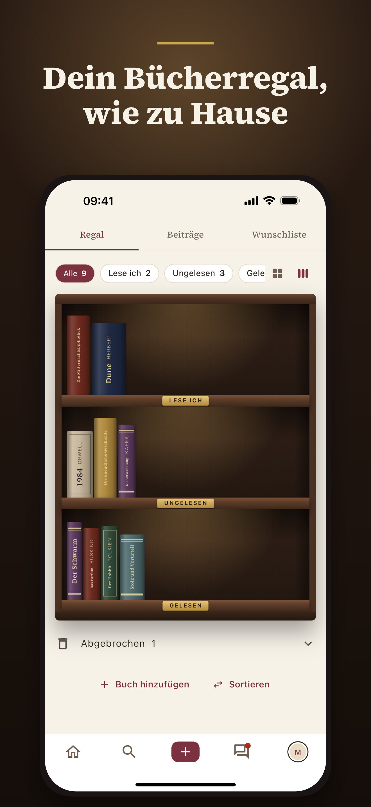
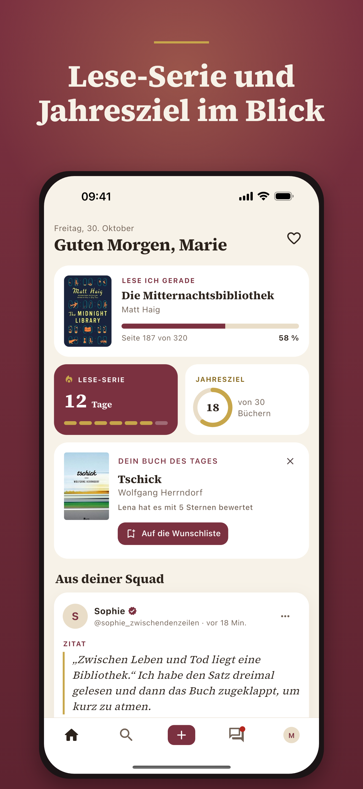
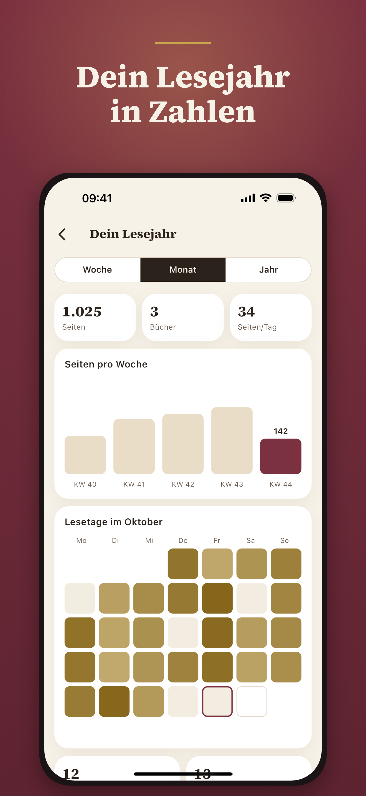
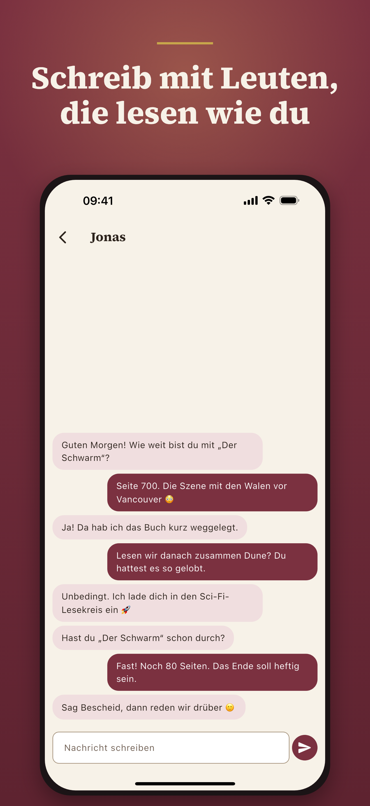
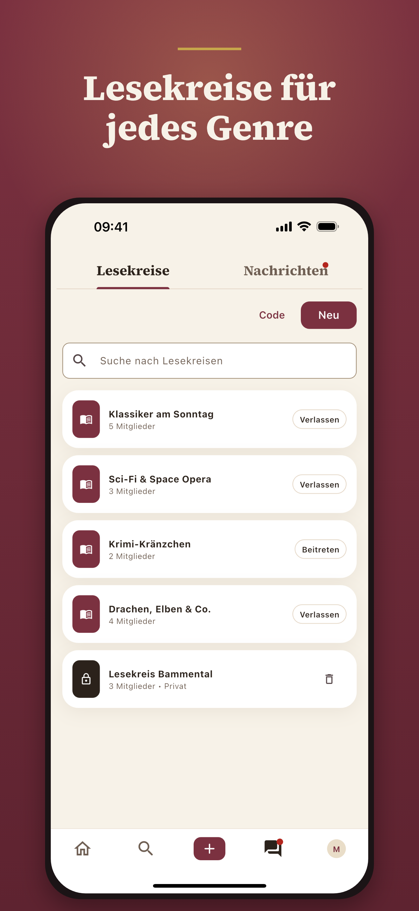
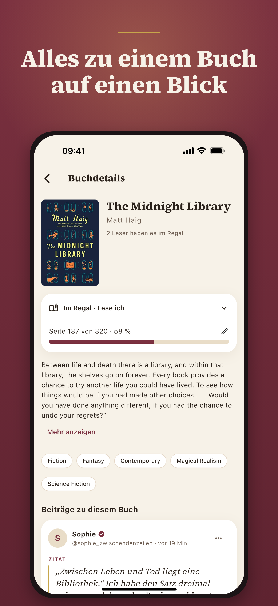
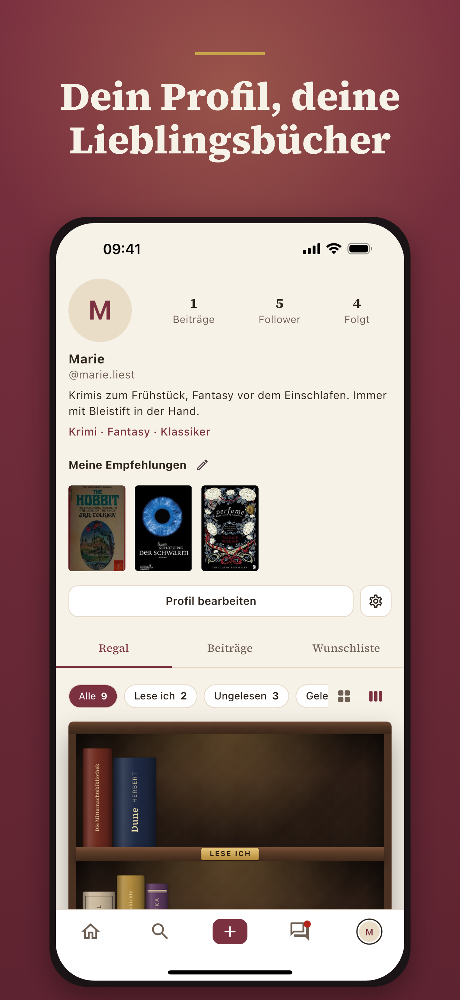
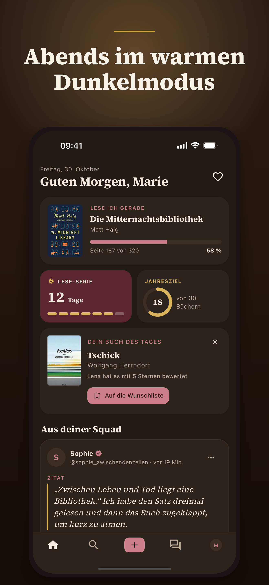

<div align="center">


# Booksquad

**Lesen mit Freunden.** Bücherregal, Rezensionen und Lesekreise in einer App.

[](https://github.com/marcellomerico/booksquad/actions/workflows/flutter.yml)


</div>

## Was ist Booksquad?

Booksquad ist eine Community-App für alle, die gerne lesen. Du hältst fest, was du liest, teilst Gedanken und Zitate und findest Menschen mit ähnlichem Buchgeschmack. In Lesekreisen sprecht ihr gemeinsam über ein Buch, öffentlich oder privat mit Einladungscode.

Keine Werbung, kein Tracking, Daten in der EU.

<table>
  <tr>
    <td></td>
    <td></td>
    <td></td>
    <td></td>
  </tr>
  <tr>
    <td></td>
    <td></td>
    <td></td>
    <td></td>
  </tr>
</table>

## Funktionen

| Bereich | Was die App kann |
|---|---|
| **Bücherregal** | Bücher, die du besitzt, auf echten Regalbrettern: „Lese ich“, „Ungelesen“, „Gelesen“, mit Sternbewertung. Suche über Open Library mit Millionen Titeln |
| **Wunschliste** | Bücher, die du haben oder lesen möchtest, getrennt vom Regal |
| **Beiträge** | Rezension, Empfehlung, Diskussion oder Zitat, mit Buch und Foto (Metadaten wie GPS werden entfernt) |
| **Feed** | Beiträge der Leute, denen du folgst, endlos scrollbar, Likes reagieren sofort |
| **Buchseiten** | Cover, Beschreibung, Themen, Leserzahl und alle Beiträge zum Buch |
| **Lesekreise** | öffentlich oder privat mit Einladungscode, eigener Feed pro Kreis |
| **Entdecken** | Vorschläge für Leser und Lesekreise passend zu deinen Lieblingsgenres |
| **Sicherheit** | Melden, Blockieren, automatisches Ausblenden nach mehreren Meldungen, Moderations-Queue für Admins, Spam-Begrenzung |
| **Profil** | Tabs Regal, Beiträge, Wunschliste; Benutzername und Anzeigename änderbar |
| **Konto** | E-Mail, Apple- und Google-Login, Passwort zurücksetzen, Konto in der App löschen |

## Teaser

[Teaser-Video ansehen (9:16, 21 s)](docs/marketing/booksquad-teaser-9x16.mp4) · neu erzeugen mit `tool/video/` (Anleitung in `tool/video/build_teaser.py`)

## Alle Screens

<table>
  <tr>
    <td align="center"><br><sub>Feed</sub></td>
    <td align="center"><br><sub>Beitrag mit Kommentaren</sub></td>
    <td align="center"><br><sub>Buchseite</sub></td>
  </tr>
  <tr>
    <td align="center"><br><sub>Bücherregal</sub></td>
    <td align="center"><br><sub>Status-Auswahl</sub></td>
    <td align="center"><br><sub>Wunschliste</sub></td>
  </tr>
  <tr>
    <td align="center"><br><sub>Profil</sub></td>
    <td align="center"><br><sub>Profil bearbeiten</sub></td>
    <td align="center"><br><sub>Profil eines Lesers</sub></td>
  </tr>
  <tr>
    <td align="center"><br><sub>Neuer Beitrag</sub></td>
    <td align="center"><br><sub>Entdecken</sub></td>
    <td align="center"><br><sub>Lesekreise</sub></td>
  </tr>
  <tr>
    <td align="center"><br><sub>Lesekreis</sub></td>
    <td align="center"><br><sub>Aktivität</sub></td>
    <td align="center"><br><sub>Einstellungen</sub></td>
  </tr>
  <tr>
    <td align="center"><br><sub>Moderation</sub></td>
    <td align="center"><br><sub>Anmelden</sub></td>
    <td align="center"><br><sub>Registrieren</sub></td>
  </tr>
</table>

## Technik

- **App:** Flutter 3.44 (iOS und Android), Riverpod, go_router, Material 3 mit eigenem Theme (Source Serif 4, Bordeaux und Creme)
- **Backend:** Supabase (Postgres, Auth, Storage, Edge Functions), Region Frankfurt
- **Sicherheit:** Row Level Security auf allen Tabellen, Hilfsfunktionen im nicht öffentlichen Schema `private`, Rate-Limits per Trigger, Konto-Löschung über eine Edge Function
- **Buchdaten:** [Open Library](https://openlibrary.org) (Suche, Cover, Beschreibungen)
- **Qualität:** 131 automatisierte Tests, `flutter analyze` ohne Befunde, CI bei jedem Push, RLS-Regressionstest und Prüfung aller Abfragen gegen das Backend

```
lib/
  core/         Theme, Router, gemeinsame Widgets, Konfiguration
  features/     auth, feed, books, groups, discover, profile, moderation, social
  models/       Datenklassen
  repositories/ Zugriff auf Supabase und Open Library
  demo/         Demo-Modus mit Beispieldaten
supabase/       Migrationen, Edge Function, Prod-Setup, RLS-Test
tool/           Release-Build, Prüfskripte, Icon- und Store-Bild-Generator
```

## Schnellstart

```bash
git clone https://github.com/marcellomerico/booksquad.git
cd booksquad
flutter pub get
cp .env.example .env   # Supabase-URL und Anon-Key eintragen
flutter run
```

**Ohne Backend ausprobieren:** Der Demo-Modus startet die App angemeldet mit Beispieldaten. Er braucht kein Supabase-Projekt.

```bash
flutter run --dart-define=BOOKSQUAD_DEMO=true
```

## Backend einrichten

Das komplette Schema liegt in [`supabase/prod_setup.sql`](supabase/prod_setup.sql) (eine Transaktion, aus den Migrationen erzeugt). Schritt für Schritt: [`docs/SUPABASE_PRODUCTION.md`](docs/SUPABASE_PRODUCTION.md). Danach die Edge Function `delete-account` deployen.

## Bilder und Branding neu erzeugen

```bash
flutter test tool/branding/render_branding_test.dart       # App-Icon und Splash
dart run flutter_launcher_icons && dart run flutter_native_splash:create
flutter test tool/branding/render_store_shots_test.dart    # Store-Bilder und Titelbild
```

Die Rohbilder in `docs/screenshots/` stammen aus dem Demo-Modus im iPhone-Simulator.

## Dokumentation

| Datei | Inhalt |
|---|---|
| [`docs/RELEASE.md`](docs/RELEASE.md) | Versionierung und Release-Builds |
| [`docs/STORE_LISTING.md`](docs/STORE_LISTING.md) | Store-Texte und Screenshot-Plan |
| [`docs/STORE_PRIVACY.md`](docs/STORE_PRIVACY.md) | Datenschutz-Angaben, Altersfreigabe, Review-Notizen |
| [`docs/SUPABASE_PRODUCTION.md`](docs/SUPABASE_PRODUCTION.md) | Produktions-Backend |
| [`docs/GOOGLE_APPLE_AUTH.md`](docs/GOOGLE_APPLE_AUTH.md) | Apple- und Google-Login |
| [`docs/legal/`](docs/legal/) | Datenschutz, Nutzungsbedingungen, Impressum |
| [`TESTING.md`](TESTING.md) | Manuelle Testanleitung |
| [`CONTRIBUTING.md`](CONTRIBUTING.md) | Arbeitsweise: Issue → Branch → Pull Request, Versionierung |

## Lizenz

Quellcode und Inhalte sind zur Ansicht veröffentlicht, **alle Rechte vorbehalten** (siehe [`LICENSE`](LICENSE)). Sicherheitslücken bitte vertraulich melden: [`SECURITY.md`](SECURITY.md).

## Status

In Vorbereitung für den Start im App Store und bei Google Play. Geplante Features stehen als [Issues](https://github.com/marcellomerico/booksquad/issues?q=is%3Aopen+label%3Afeature).
