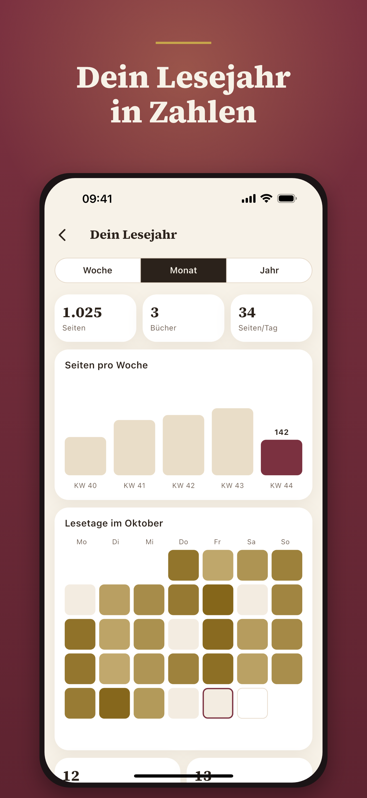
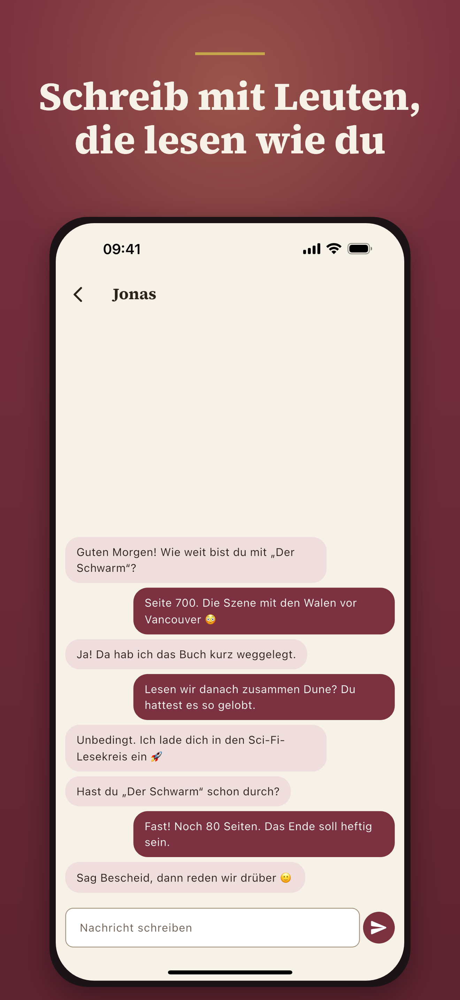
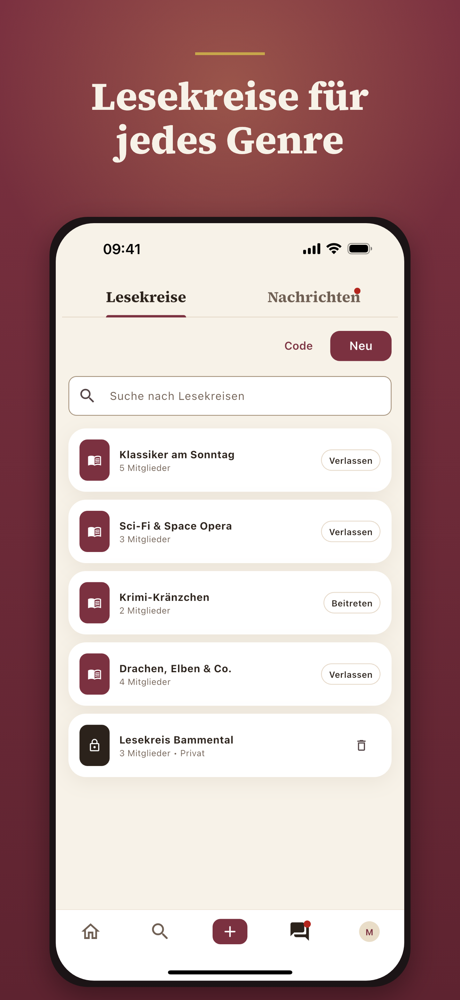
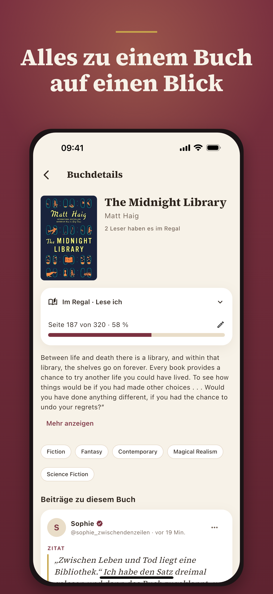
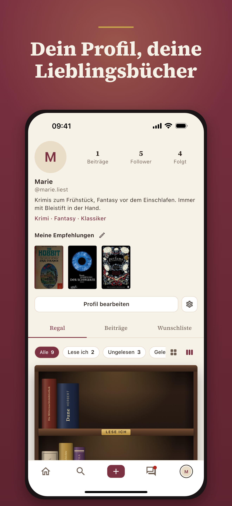

<div align="center">


# Booksquad

**Lesen mit Freunden.** Bücherregal, Rezensionen und Lesekreise in einer App.

[](https://github.com/marcellomerico/booksquad/actions/workflows/flutter.yml)


</div>

## Was ist Booksquad?

Booksquad ist eine Community-App für alle, die gerne lesen. Du hältst fest, was du liest, teilst Gedanken und Zitate und findest Menschen mit ähnlichem Buchgeschmack. In Lesekreisen sprecht ihr gemeinsam über ein Buch, öffentlich oder privat mit Einladungscode.

Keine Werbung, kein Tracking, Daten in der EU.

<table>
  <tr>
    <td></td>
    <td></td>
    <td></td>
    <td></td>
  </tr>
  <tr>
    <td></td>
    <td></td>
    <td></td>
    <td></td>
  </tr>
</table>

## Funktionen

| Bereich | Was die App kann |
|---|---|
| **Bücherregal** | Walnuss-Regal mit Buchrücken oder Covern, Fächer „Lese ich“, „Ungelesen“, „Gelesen“ und eine Ecke für Abgebrochenes, eigene Reihenfolge per Ziehen. Suche über Open Library mit Millionen Titeln |
| **Lesefortschritt** | Aktuelle Seite pro Buch, Lese-Serie, Jahresziel und Statistik mit Seiten pro Woche, Büchern pro Monat und Lesetage-Kalender |
| **Wunschliste** | Bücher, die du haben oder lesen möchtest, getrennt vom Regal |
| **Beiträge** | Rezension, Empfehlung, Diskussion oder Zitat, mit Buch und Foto (Metadaten wie GPS werden entfernt) |
| **Feed** | Beiträge der Leute, denen du folgst, dazu täglich ein Buchvorschlag aus deiner Squad |
| **Lesekreise und Nachrichten** | Öffentliche oder private Lesekreise mit Einladungscode, Direktnachrichten in Echtzeit zwischen Lesern, die sich gegenseitig folgen |
| **Profil** | Bio, Lieblingsgenres, drei Empfehlungen, Verifizierungs-Haken, private Konten mit Folgeanfragen |
| **Sicherheit** | Melden, Blockieren und Entsperren, automatisches Ausblenden nach mehreren Meldungen, Moderations-Queue für Admins, Spam-Begrenzung |
| **Darstellung** | Warmer Hell- und Dunkelmodus, Animationen, die „Bewegung reduzieren“ respektieren |
| **Konto** | E-Mail, Apple- und Google-Login, Passwort zurücksetzen, Konto in der App löschen |

[Teaser-Video ansehen (9:16, 21 s)](site/img/teaser.mp4)

## Technik

- **App:** Flutter 3.44 (iOS und Android), Riverpod, go_router, Material 3 mit eigenem Theme (Source Serif 4, Bordeaux, Creme und Walnuss, hell und dunkel)
- **Backend:** Supabase (Postgres, Auth, Storage, Realtime, Edge Functions), Region Frankfurt
- **Sicherheit:** Row Level Security auf allen Tabellen, Hilfsfunktionen im nicht öffentlichen Schema `private`, Rate-Limits per Trigger, Konto-Löschung über eine Edge Function
- **Buchdaten:** [Open Library](https://openlibrary.org) (Suche, Cover, Beschreibungen)
- **Qualität:** über 180 automatisierte Tests, `flutter analyze` ohne Befunde, CI mit Tests und Android-Build bei jedem Push, RLS-Regressionstest und Prüfung aller Abfragen gegen das Backend

```
lib/
  core/         Theme, Router, gemeinsame Widgets, Konfiguration
  features/     auth, feed, books, stats, groups, messages, discover, profile, moderation, social
  models/       Datenklassen
  repositories/ Zugriff auf Supabase und Open Library
  demo/         Demo-Modus mit Beispieldaten
supabase/       Migrationen, Edge Functions, Prod-Setup, RLS-Test
site/           Website booksquad.de mit Rechtstexten
tool/           Release-Build, Prüfskripte, Icon- und Store-Bild-Generator
```

## Schnellstart

```bash
git clone https://github.com/marcellomerico/booksquad.git
cd booksquad
flutter pub get
printf 'SUPABASE_URL=...\nSUPABASE_ANON_KEY=...\n' > .env   # eigenes Supabase-Projekt
flutter run
```

**Ohne Backend ausprobieren:** Der Demo-Modus startet die App angemeldet mit Beispieldaten. Er braucht kein Supabase-Projekt.

```bash
flutter run --dart-define=BOOKSQUAD_DEMO=true
```

## Backend einrichten

Das komplette Schema liegt in [`supabase/prod_setup.sql`](supabase/prod_setup.sql) (eine Transaktion, aus den Migrationen erzeugt). Danach die Edge Functions in `supabase/functions/` deployen.

## Bilder und Branding neu erzeugen

```bash
flutter test tool/branding/render_branding_test.dart       # App-Icon und Splash
dart run flutter_launcher_icons && dart run flutter_native_splash:create
flutter test tool/branding/render_store_shots_test.dart    # Store-Bilder und Titelbild
```

Die Rohbilder in `docs/screenshots/` stammen aus dem Demo-Modus im iPhone-Simulator.

## Rechtstexte

Datenschutz, Nutzungsbedingungen und Impressum liegen in [`docs/legal/`](docs/legal/) und werden mit `python3 tool/build_site.py .` nach `site/` übertragen.

## Lizenz

Quellcode und Inhalte sind zur Ansicht veröffentlicht, **alle Rechte vorbehalten** (siehe [`LICENSE`](LICENSE)). Sicherheitslücken bitte vertraulich melden: [`SECURITY.md`](SECURITY.md).

## Status

In Vorbereitung für den Start im App Store und bei Google Play. Geplante Features stehen als [Issues](https://github.com/marcellomerico/booksquad/issues?q=is%3Aopen+label%3Afeature).
